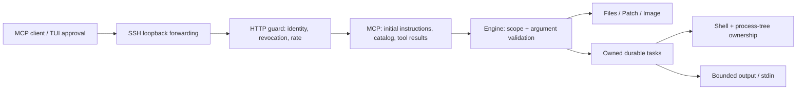

# Architecture and protocol decisions

## Purpose

Give any compatible MCP host a direct remote hand on the local machine. There is no second LLM, executor adapter, or runtime script layer. The host owns its approval policy.

The HTTP transport is stateless. Durable tasks are explicit handles. Every HTTP request authenticates independently; every task access checks the principal associated with the credential. No caller-controlled `owner` or conversation ID is accepted.

## Discovery and model context

MCP initialization returns `instructions`, including the local OS, default cwd, permitted operation signatures, retry rules, process lifetime and output continuation. Details are not appended to every tool result. The server offers two stable catalogs:

- **compact**: `Run {tool,arguments}` and `Discover {tool?}`. The complete operation schemas remain on the server. `Discover` retrieves one permitted schema when needed; without a name it returns short descriptions. Both paths use exactly the same authorization and validation as native calls.
- **native**: thirteen separate strongly typed tools. Clients can display individual operations and use native permission policies. A read-only credential sees only its permitted tools.

Compact mode trades per-operation schema constraints at the model API for a smaller registered catalog. Server validation is unchanged. Its single `Run` definition has conservative mutating annotations, because a read-only hint cannot safely describe every dispatched operation. A TUI must inspect the nested operation and arguments before approval.

The server controls the catalog it serves and the initialization content. It cannot control whether a particular MCP host uses `instructions`, how often it calls `tools/list`, whether it includes definitions in every model request, or whether the model provider caches a prompt prefix. If the host ignores initialization instructions, `Discover` is an explicit fallback. Native mode remains available if a host handles dynamic argument objects poorly.

References: [MCP 2025-11-25 lifecycle](https://modelcontextprotocol.io/specification/2025-11-25/basic/lifecycle), [tools](https://modelcontextprotocol.io/specification/2025-11-25/server/tools). The wire protocol remains 2025-11-25 with negotiated compatibility for 2025-03-26 and 2025-06-18; this release does not claim implementation of the newer 2026 protocol.

## Authentication

This is a **private SSH transport with local personal access credentials**, not an OAuth authorization server. Listener and reverse listener bind to loopback. Arbitrary browser Origin headers and non-loopback Host values are rejected. Do not expose its plaintext HTTP listener directly to the internet. An internet-facing multi-user deployment needs a separately designed TLS/OAuth resource server integration; standard OAuth discovery and interactive authorization are not advertised here.

The CLI issues a 256-bit random secret plus an opaque credential ID. The store persists only the SHA-256 digest of the full token. Constant-time comparison verifies a supplied token. Credentials have an identity, label, scopes, expiry, revocation flag and catalog profile. The auth file is reloaded on each request, so changes take effect without restarting the executor. A new key can retain an existing principal for rotation; issuing a different principal separates task lookup/list/cancel/input/retry ownership. Revocation rejects subsequent requests; it does not undo file writes or automatically cancel already accepted jobs.

Scopes are `read`, `write`, `exec`, `tasks`, or `*`. File tools also enforce the credential's workspace roots (default: configured cwd) and protected executor paths, resolving existing links and lexical parent components. The first granted root is that credential's default cwd. `Info` and catalog discovery do not grant operation permissions. A compact dispatcher cannot bypass the underlying operation scope. Every operation is validated against the same bounded schema subset used in its published definition. JSON-RPC sessions, tool annotations and task IDs are not credentials.

Windows `init` protects its newly created private directory with the current user and SYSTEM ACLs. `token issue --token-file` protects that file without changing its parent's ACL. The operator must also protect pre-existing/imported deployments. Token plaintext necessarily exists in the consuming client's private configuration. It is excluded from logs, reports and archives.

The permission model combines scopes, file workspace checks and the current OS account. `exec` gives that account's full execution capability and can operate outside the file-tool roots. Task ownership prevents cross-client operations through the task API; it is not isolation against an execution-capable client reading another process's files. There is no OS sandbox.

## Local management

An optional separate loopback-only listener serves the embedded UI and its own API. MCP Bearer credentials cannot authenticate to this listener. A local `reach ui` invocation writes the hash of a 256-bit, three-minute single-use ticket to a private file and opens a URL fragment. The page removes the fragment before login, consumes the ticket, and receives an HttpOnly/SameSite=Strict cookie. Management sessions are in memory, expire after eight hours or thirty minutes idle, and disappear on restart. Mutation requests require JSON and a separate CSRF token; exact Host and same-origin checks reject cross-site use. CSP uses only local scripts/styles with no CDN or analytics.

The UI creates a unique principal for each new client, returns a text Bearer key and an MCP config snippet once, and supports rotation, revocation and task cancellation. Rotation keeps the principal, roots and scopes, immediately revokes the old key and requires updating the client. Revoking a key blocks later calls, not already accepted work; task cancellation is a separate action. Management events are included in the redacted audit log. `init --no-admin` disables the UI; CLI credential management works independently.

## Task and process lifetime

Mutating operations get an automatic task UUID. Explicit retry uses an existing ID and identical normalized arguments, cwd and principal. A response lost in transit is recovered with Tasks/Poll. Disconnecting HTTP does not cancel accepted work. Restart marks unfinished records interrupted without replaying them.

Windows Job Objects own Shell/SSH process trees. Four jobs run concurrently and at most 32 may be active/queued. File mutations share a gate; shell commands may modify files independently. Use read hashes or separate worktrees for concurrent editing. Process timeout and MCP response wait are separate. Pipe input is opt-in; no PTY, interactive full-screen terminal, or persistent shell cwd is claimed.

Poll reads bounded stdout/stderr pages using byte offsets. Initial Shell results contain a preview; Poll omits that old preview to avoid repeating it. Each stream stores up to 16 MiB; each inline page is at most 12 KB. Durable task records and logs are retained until intentionally removed. Removing records also removes historical retry deduplication. Audit rows contain identity, credential ID, operation, request outcome and duration, never command arguments or file contents. Audit I/O failures are reported on stderr; this release is not a tamper-proof audit system.

## File changes and images

Write/Edit are per-file atomic. ApplyPatch supports contextual add/update/delete/move, unique matching, optional hash guards and CRLF preservation. It validates every planned file before committing and attempts rollback on an ordinary commit failure. Multi-file changes are not crash-atomic and are not protected from unrelated OS processes writing between checks. Write destinations precede deletions. Patch paths stay relative to cwd and may not leave it through existing links.

Image returns native MCP image content plus small metadata; base64 is not duplicated into text or structured metadata. Accepted image signatures are PNG/JPEG/GIF/WebP, up to 8 MiB. Host/model image support varies.

## Modules

